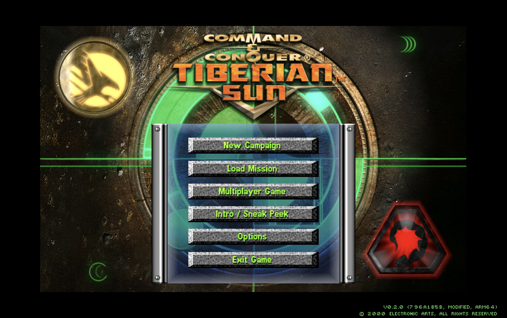
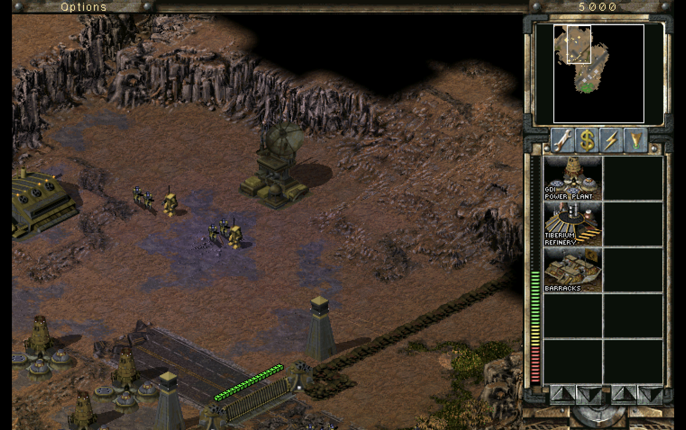

# siliconsun

siliconsun is an Apple Silicon client of *Command & Conquer: Tiberian Sun*, and
a Windows x64 client of the same engine, [OpenTS](https://github.com/OpenTS-Developers/OpenTS).
OpenTS rebuilds the engine as a standalone program instead of patching the
retail executable; siliconsun adds an arm64 macOS build and some QoL fixes. The
[OpenTS guide](https://opents-developers.github.io/OpenTS/) covers the engine
and its Windows build.

---

> a very proud screenshot of the first successful menu build on MacBook Air M5 (macOS 27)



> Tiberian Sun - GDI Mission 1 (Reinforce Phoenix Base)


## Install

Download the release for your platform. The game ships without Tiberian Sun's
data, so a launch whose data directory has no `TIBSUN.MIX` shows a setup screen.
Choose **Download** to fetch the freeware files, or **Folder** to copy an
existing install.

- Tiberian Sun game data and music are always included.
- The campaign cinematics are optional.
- Firestorm game data and music are optional.
- The Firestorm cinematics are optional and also include Firestorm.

The screen shows each part's size and the speed of a running transfer. A
partial download resumes, and a file that finishes with the wrong checksum is
removed. **Restart** starts the game when setup finishes.

The files land in the data directory. They are Electronic Arts' freeware
release and are not covered by the siliconsun license. A `-DATADIR` path that
does not exist is refused, and headless or spawned runs skip the screen.

### Windows

`siliconsun-<tag>-x64.zip` holds `SUN.EXE`, `Language.dll`, `ui`, `Game.pdb`,
and the license notices. Unzip it into the Steam Tiberian Sun folder to replace
the original executable, or run `SUN.EXE -DATADIR=<path>` from the unzipped
folder. The Steam Deck runs this build under Proton 11.

> [!WARNING]
> Back up `Saved Games` before you replace `SUN.EXE`. OpenTS and the original
> game do not load each other's saves, and there is no converter. The guide's
> [compatibility and saves](https://opents-developers.github.io/OpenTS/using/compatibility-and-saves/)
> page covers the rest.

### macOS

`siliconsun-<tag>-macos.zip` holds `siliconsun.app` and the license notices. It
is an arm64 application signed with a Developer ID and notarized, so Gatekeeper
opens it normally. A copy with an ad-hoc signature, such as a local build you
share, stays blocked until you run this from the folder that holds it:

```bash
xattr -dr com.apple.quarantine siliconsun.app
open siliconsun.app
```

The app reads game data from `~/Games/OpenTS`, creating that folder on an
interactive launch, and writes settings and saves to
`~/Library/Application Support/siliconsun`. Replacing the app leaves both in
place. Pass `-DATADIR` and `-USERDIR` to use other folders:

```bash
open siliconsun.app --args -DATADIR="$HOME/Games/OpenTS" -USERDIR="$HOME/Library/Application Support/siliconsun"
```

## siliconsun settings

Player options live in `SUN.INI`. [SETTINGS.md](SETTINGS.md) lists the keys this
client adds or changes, with their defaults and what each does.

## Steam install

`.agents/skills/steam-release/` rebuilds the x64 Release and replaces
`SUN.EXE`, `Language.dll`, `Game.pdb`, and `ui/` in the Steam install. A build
that is not x64 is refused. Back up `Saved Games` first.

```powershell
powershell -NoProfile -ExecutionPolicy Bypass -File .agents\skills\steam-release\scripts\deploy.ps1
```

## Building

On macOS, with Apple Clang and Ninja on arm64:

```bash
brew install cmake ninja
git submodule update --init --recursive
cmake -S . -B build/macos -G Ninja -DCMAKE_BUILD_TYPE=Debug -DCMAKE_EXPORT_COMPILE_COMMANDS=ON
cmake --build build/macos
```

The binary is `build/macos/bin/GameD`. Run it with
`-DATADIR="$HOME/Games/OpenTS"`. On Windows, follow the guide's
[build and run](https://opents-developers.github.io/OpenTS/using/build-and-run/)
page and pass `-A x64`.

## Discord status

The game talks to the Discord desktop client over its local IPC channel. There
is no server, and no Discord library is in the build. The application ID is
`1565832094893211698`, set by the CMake cache variable
`SILICONSUN_DISCORD_APPLICATION_ID`. Set it to `0` and the game never contacts
Discord, even with `DiscordPresence=yes`.

## Working on this fork

`main` is this fork's commits rebased onto `upstream/main`:

```bash
git remote add upstream https://github.com/OpenTS-Developers/OpenTS.git   # once
git fetch upstream
git rebase upstream/main
```

Hide upstream paths instead of deleting them. A deletion commit removes only
the files that existed then, and upstream adds files under `manual/` in almost
every commit, so a deleted tree partly returns on the next rebase.

```powershell
git sparse-checkout init --cone
git sparse-checkout set .agents .claude .cursor .github .vscode Run cmake code docs tests thirdparty ui workers
```

That hides `manual/`. The files stay tracked: `git sparse-checkout add manual`
shows the tree again, `git show main:manual/changes/<name>.md` reads one file,
and `git sparse-checkout disable` restores the whole checkout.

Renaming or deleting a path that upstream still edits conflicts the next time
upstream changes it. Put product naming in text and artwork instead:
`README.md`, the window title, `project()` in `CMakeLists.txt`, and the icon.
Paths under `code/`, `docs/`, `tests/`, and `manual/` keep their upstream
names.

A path that `git ls-tree upstream/main -- <path>` does not list belongs to this
fork. The main ones:

| Path | Owner |
| --- | --- |
| `workers/`, `.agents/skills/`, `README.md`, `SETTINGS.md`, `.github/workflows/engine-release.yml` | this fork |
| `code/content*`, `code/discord*`, `code/nowplaying*`, `code/darwin.*`, `code/ui/screens/install/`, `code/resources/app-icon/siliconsun.*` | this fork |
| `manual/`, `docs/`, `tests/`, the other `.github/workflows/` | upstream |

## License

This fork keeps the upstream license: GPL-3.0-or-later, with the additional
Section 7 terms for material derived from Electronic Arts source. See
[LICENSE.md](LICENSE.md).
